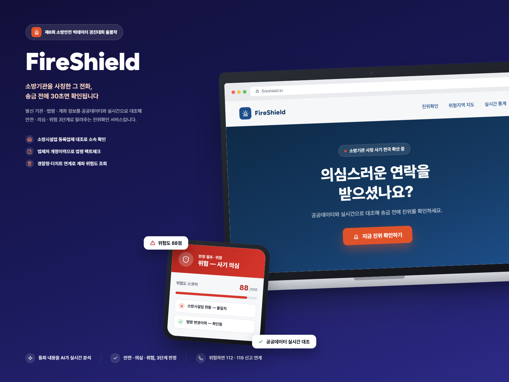
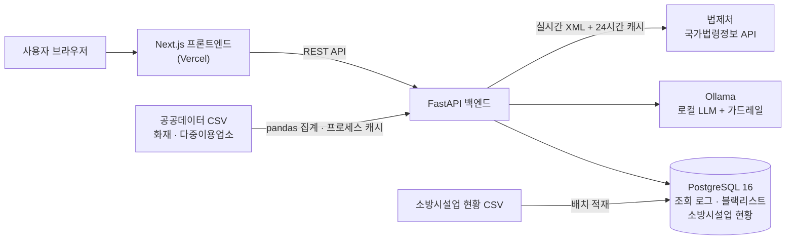
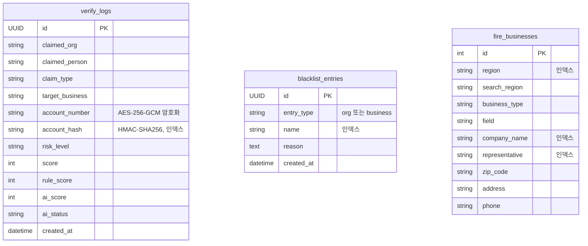

<div align="center">

# FireShield

### 소방기관을 사칭한 그 전화, 송금 전에 30초면 확인됩니다



</div>

<br>

---

## 프로젝트 소개

송금 직전 단계에서 소방기관 사칭 사기 여부를 **실시간으로 진위확인**해주는 웹 서비스입니다.

발신 기관·법령·계좌 정보를 공공데이터와 대조하고, **규칙 기반 판정과 로컬 LLM 판정을 결합**해 안전·의심·위험 3단계로 알려줍니다. 공공데이터로 실체를 확인할 수 없는 경우에는 섣불리 안전하다고 판정하지 않고, **추가 확인 권장**으로 안내해 관할 소방서에 확인하도록 돕습니다.

> 🏆 [제6회 소방안전 빅데이터 경진대회](https://bigdata-119.kr/bbs/view?bbsctt_id=571) 출품작

<br>

---

## 개발 동기

최근 경북에서 6.3억 원, 제주에서 8,070만 원 규모의 소방기관 사칭 사기 피해가 발생했습니다. 사기범은 소방서·소방청 등 공공기관을 사칭해 민박·모텔·단란주점·노래연습장 같은 소규모 영업장 사업주에게 접근하고, "법령 개정으로 소화기 교체가 의무화됐다", "정부 보조금이 전액 환급된다"는 명목으로 금전을 요구하는 수법을 반복하고 있습니다.

이런 유형의 사기는 전화를 받는 그 순간 판단할 시간이 거의 없다는 점에서 **골든타임 대응**이 핵심입니다. 그래서 설치나 회원가입 없이 URL 접속만으로, 송금 직전에 즉시 진위를 확인할 수 있는 반응형 웹 서비스를 기획했습니다.

<br>

---

## 팀원 구성

<div align="center">

| **최윤정** |
| :------: |
| 개인 프로젝트 |
| 기획 · 백엔드 · 프론트엔드 |

</div>

<br>

---

## 1. 개발 기간 및 작업 관리

### 개발 기간

- 전체 개발 기간 : 2026.07.27 ~ 진행 중

<br>

### 작업 관리

- GitHub로 버전을 관리하고, GitHub Actions로 PR·push마다 린트와 테스트를 자동 실행합니다.
- Notion에 기획서·요구사항 명세서·스토리보드를 정리하고, Figma로 화면을 설계했습니다.

<br>

---

## 2. 개발 환경

- **Backend** : Python 3.12, FastAPI, SQLAlchemy 2.0 (async), PostgreSQL 16
- **Frontend** : TypeScript, Next.js 16, React 19, Tailwind CSS v4
- **AI** : Ollama (gemma2:2b, 로컬 LLM)
- **배포** : Docker Compose (로컬 DB), Vercel (프론트엔드), GitHub Actions (CI/CD)
- **버전 관리** : Github, Dependabot
- **협업 툴** : Notion, Github
- **디자인** : Figma

<br>

---

## 3. 기술 스택

### 기술 선정 이유

#### FastAPI
- 법제처 API 실시간 호출, 로컬 LLM 동시 실행처럼 I/O 대기가 많은 작업이 핵심 로직이라 비동기 처리가 중요했습니다.
- SQLAlchemy 2.0 async와 조합해 규칙 기반 판정과 AI 판정을 동시에 실행하면서도 응답 지연을 최소화했습니다.
- Pydantic v2 기반 요청 검증이 무의미 입력 거부 같은 입력 유효성 검사와 잘 맞았습니다.

#### PostgreSQL
- 계좌번호 암호화 저장, 조회 로그·블랙리스트·소방시설업 현황 등 정형 데이터를 다루는 서비스 특성상 관계형 DB가 적합했습니다.
- SQLAlchemy 2.0 async와의 호환성과 안정적인 트랜잭션 처리를 고려해 선택했습니다.

#### Ollama (로컬 LLM)
- 사기 의심 내용 같은 민감한 정보를 외부 LLM API로 보내지 않고 자체 서버에서 처리하기 위해 선택했습니다.
- gemma2:2b는 GPU 없이 CPU로도 구동되는 경량 모델이라 고비용 인프라 없이 실시간 판정에 활용할 수 있습니다.

#### Next.js · TypeScript
- 입력폼 → 결과 카드 → 위험지도 → 관리자 페이지로 이어지는 화면을 컴포넌트 단위로 구성하고 페이지별 라우팅을 관리하기 좋았습니다.
- `risk_level`, `evidence`, `ai_assessment` 같은 응답 구조를 타입으로 정의해 런타임 오류를 사전에 방지했습니다.

#### Docker Compose
- PostgreSQL 등 서비스 의존성을 로컬 개발 환경에서 일관되게 재현하기 위해 선택했습니다.

<br>

### 기술 스택 상세

| 구분 | 기술 |
|------|------|
| Language |  Python 3.12, TypeScript 5 |
| Backend |  FastAPI, Pydantic v2, httpx, pandas |
| Database | PostgreSQL 16, SQLAlchemy 2.0 (async), asyncpg |
| AI | Ollama (gemma2:2b) |
| Security | AES-256-GCM, HMAC-SHA256 |
| Frontend |  Next.js 16,  React 19,  Tailwind CSS v4 |
| Map | Google Maps JavaScript API |
| Test | pytest, pytest-asyncio, ruff, ESLint |
| Infra |  Vercel, Docker Compose, GitHub Actions |
| API Docs | Swagger (FastAPI 내장) |
| Collaboration |  Github, Notion, Figma |

<br>

---

## 4. ☁️ 서비스 아키텍처



<br>

---

## 5. 🗄 ERD

세 테이블은 서로 외래키 없이 독립적으로 사용합니다.



<br>

---

## 6. 📁 프로젝트 구조

```
fireshield/
├── .github/
│   ├── workflows/ci.yml      # 린트 · 테스트 · 빌드 · Vercel 배포
│   └── dependabot.yml        # pip · npm · GitHub Actions 의존성 관리
├── backend/
│   ├── app/
│   │   ├── api/v1/           # verify, risk_map, public_stats, admin 라우터
│   │   ├── core/             # 설정, DB, 암호화, 관리자 인증
│   │   ├── models/           # SQLAlchemy 모델
│   │   ├── schemas/          # Pydantic 요청/응답 스키마
│   │   └── services/         # 법제처 조회, AI 판정, 가드레일, 계좌 이력, 위험지도
│   ├── data/                 # 공공데이터 CSV
│   ├── scripts/              # 소방시설업 현황 적재 스크립트
│   ├── tests/                # pytest 테스트 100개
│   └── docker-compose.yml    # PostgreSQL
└── frontend/
    └── src/
        ├── app/              # /, /stats, /guide, /admin 페이지
        ├── components/       # 입력폼, 결과 카드, 위험지도, 통계, 관리자 UI
        ├── lib/              # API 클라이언트, 위험도 표시 유틸
        └── types/            # API 응답 타입
```

<br>

---

## 7. 구현 내용

**실시간 진위확인 판정 엔진** `FastAPI` `asyncio`
- 블랙리스트 대조 → 법제처 조회 → 소방시설업 현황 대조 → 사기 문구 패턴 분석 → 계좌번호 요구 가중치 → 계좌 사기 신고 이력 조회 → 규칙 점수 산출로 이어지는 7단계 판정 로직 구현
- 300줄짜리 엔드포인트를 검사 단계별 함수로 분리 (입력 조합 6,912개에 대해 리팩토링 전후 응답 동일성 검증)
- AI 판정과 법제처 조회를 `asyncio` 태스크로 DB 대조와 동시에 실행해 응답 지연 최소화
- 법제처 API를 실시간 XML로 연동하고 24시간 인메모리 캐시를 적용해 허위 법령명·없는 개정 사항 탐지

**로컬 LLM 판정 및 가드레일** `Ollama` `가드레일`
- 규칙 기반 판정과 동시에 로컬 LLM을 실행해 사기 위험도를 이중으로 검증
- 모델이 응답하지 않거나 이상 출력을 내면 규칙 점수로 자동 폴백해 AI 판정이 실패해도 서비스가 정상 동작하도록 설계
- 서버 기동 시 모델을 예열(keep_alive 30분)해 콜드스타트 지연 최소화

**입력 검증 및 추가 확인 권장 판정** `Pydantic v2`
- 자모만 입력, 같은 글자 반복, 모든 항목 동일값 같은 무의미 입력을 422로 거부
- 사기 신호도 없고 공공데이터로 실체 확인도 안 되는 경우를 `unverified`(추가 확인 권장)로 분리해 오탐 최소화

**개인정보 보호** `AES-256-GCM` `HMAC-SHA256`
- 계좌번호를 AES-256-GCM으로 암호화해 저장
- 반복 신고 집계용으로 복호화가 불가능한 HMAC-SHA256 단방향 해시를 별도 저장 (하이픈·공백을 제거해 표기가 달라도 같은 계좌로 인식)

**계좌번호 사기 신고 이력 조회** `Provider 패턴`
- 경찰청 '사이버사기 피해신고 이력조회'는 공식 API가 없어, 같은 계좌번호가 최근 90일간 3회 이상 '위험/의심'으로 조회됐는지 자체 로그로 집계 (경찰청과 동일 기준)
- 결과 화면에서 경찰청·더치트 공식 조회 페이지로 딥링크 제공
- Provider 인터페이스로 분리해 외부 데이터 계약 시 구현체만 교체 가능하도록 설계

**관리자 기능** `X-Admin-Key`
- 위험도별 조회 건수 통계, 계좌번호를 마스킹한 조회 로그, 블랙리스트 관리 기능 구현
- X-Admin-Key를 상수시간 비교로 검증하는 관리자 인증 구현
- 위험도별 집계를 공통 서비스로 추출하고 요청당 쿼리를 5회 → 1회로 축소

**테스트 · CI/CD** `pytest` `GitHub Actions` `Vercel`
- /verify 통합, 가드레일 단위, 관리자, 공개 통계, 위험지도, 계좌 이력, 암호화 등 테스트 100개 작성
- PR·push마다 `ruff` + `pytest`, 프론트엔드 `lint` + `build`를 실행하고, main에 push되어 통과하면 Vercel로 자동 배포
- Dependabot으로 의존성을 관리하고 Next.js 크리티컬 RCE 취약점(GHSA-p293-qw3h-jr36) 패치

<br>

---

## 8. ✨ 주요 기능

### 🛡️ 소방기관 사칭 진위확인
- 발신 기관명, 담당자명, 요구 사유, 대상 업체, 법령명, 계좌번호를 입력해 진위 확인
- **법제처 국가법령정보 API**로 언급된 법령과 최근 개정 이력을 실시간 조회
- **소방시설업 현황** 10,465건과 대조해 등록 업체 여부 확인
- 0~100점 위험 점수와 안전 · 의심 · 위험 3단계 판정 제공, 공공데이터로 확인되지 않으면 추가 확인 권장으로 안내
- 규칙 점수와 AI 점수를 나눠서 보여주고, AI가 반영되지 않은 경우 사유 안내
- 위험 판정 시 112 · 119 신고 안내

### 🤖 AI 판정 가드레일

로컬 모델의 이상 출력은 `app/services/ai_guardrail.py`가 판정 전에 걸러냅니다.

| 모델이 내놓은 값 | 가드레일 처리 |
|---|---|
| `NaN` / `Infinity` / 파싱 불가능한 산문 | **폐기** — 규칙 점수로 폴백, 이상 징후 로깅 |
| `250`, `-0.4` 처럼 범위 밖 숫자 | 0~100으로 **클램프**, 방향은 유지 |
| `"80%"`, `0.87`, `73/100` 등 다양한 표기 | 0~100 스케일로 **정규화** |
| 규칙 점수와 45점 이상 상충 (예: 규칙 85 / AI 2) | **폐기** — 보수적으로 규칙 점수 신뢰 |
| 40~60점 중립 구간 | 참고용으로만 표시, 최종 판정에는 미반영 |
| Ollama 미기동 / 타임아웃 | **폐기** — 규칙 점수만으로 정상 응답 |

최종 점수는 신뢰할 수 있는 AI 점수가 규칙 점수보다 높을 때만 보수적으로 상향(`max`)합니다.

### 🗺️ 화재 위험지역 지도
- 화재 현황과 다중이용업소 현황을 결합해 시/도별 위험도 시각화
- 시/도 → 시/군/구 드릴다운 조회
- Google Maps JavaScript API 연동

### 📊 공개 통계 · 사기 유형 안내
- 위험도별 건수, 최근 14일 추이, 많이 사칭된 기관, 최근 경보 공개 (개인정보 미노출)
- 실제 피해 사례, 자주 쓰이는 사기 멘트, 의심 신호 체크리스트 안내 (`/guide`)

### 🔐 관리자 페이지
- 조회 통계와 마스킹된 조회 로그 확인
- 사칭 신고 기관·업체명 블랙리스트 관리

<br>

---

## 9. 🚀 기술적 성과

### AI 판정 시간 단축
프롬프트 축약과 응답 prefill로 생성 토큰 수를 줄여 판정 시간 **4.9초 → 2.3초** (새 입력 기준 중앙값)

### 위험지도 응답 속도 개선
CSV 파싱·집계 결과를 프로세스 단위로 캐싱하고 기동 시 예열해 **1.8초 → 7.5ms**

### 집계 쿼리 축소
위험도별 건수 집계를 필터 집계로 통합해 요청당 쿼리 **5회 → 1회**

### 공공데이터 가공
원본을 그대로 쓰지 않고 서비스 목적에 맞게 필터링하고 재구성했습니다.

| 원본 데이터 | 문제 | 처리 방식 |
|---|---|---|
| 전국 화재 현황 (38,409건) | 1년치 데이터라 "최근 3개월" 서비스 맥락에 비해 과다 | 데이터 내 최신 접수일 기준 최근 90일만 필터링 |
| 전국 다중이용업소 현황 (24,546건) | 시/도가 주소 텍스트에 섞여 있고 폐업 이력이 포함됨 | 주소에서 시/도를 추출하고 영업 중(`USE_YN=Y`)인 건만 집계 |
| 소방시설업 현황 (10,465건) | CP949 인코딩, 결측치가 NaN(float)으로 남아 DB 저장 시 타입 오류 | 문자열 정규화 후 적재, 업체명·대표자·지역 컬럼 인덱싱 |
| 화재 현황 + 다중이용업소 현황 | 별도 제공되어 단순 합산으로는 위험도 판단이 어려움 | 시/도 단위로 결합하고 가중합산해 0~100 위험 점수로 정규화 |

<br>

---

## 10. 💥 트러블 슈팅

<details>
<summary><b>로컬 LLM 사기 판정 응답 지연 (4.9초 → 2.3초)</b></summary>

<br>

**문제 상황**
- 진위확인 요청 한 건의 응답에 평균 약 4.9초가 걸려, 골든타임 대응이 핵심인 서비스에서 치명적인 지연이 발생

**문제 원인**
- 구간별로 실측해 보니 DB 쿼리는 1~9ms뿐이고, 대부분은 Ollama가 CPU에서 프롬프트를 읽는 시간(약 50토큰/초)
- 모델이 JSON 전체를 생성해 출력 토큰이 많았고, 법제처 조회는 DB 대조 후 순차로 실행됨

**해결 과정**
- 지시문을 축약해 프롬프트를 190 → 120토큰으로 축소
- `/api/generate` → `/api/chat`으로 전환하고 `{"scam_probability": `를 미리 채워(prefill) 숫자만 생성하도록 변경 (생성 12 → 3~4토큰)
- `OLLAMA_NUM_THREAD` 설정을 추가하고 예열과 실제 요청이 같은 값을 쓰도록 해 모델 재로딩 방지
- 법제처 조회를 DB 대조 전에 시작해 AI 판정과 동시에 진행
- 결과 : 중앙값 4.9초 → 3.0초(코드 변경) → 2.3초(스레드 설정), 판정값은 13건 중 12건 동일 (1건도 같은 위험 구간)

**배운 점**
- 추측이 아니라 구간별 실측으로 병목을 찾는 것이 먼저라는 것을 체감
- CPU 환경의 LLM 응답 시간은 입·출력 토큰 수에 비례하므로, 프롬프트와 출력 형식 설계 자체가 성능 최적화라는 것을 이해

</details>

<details>
<summary><b>화재 위험지역 지도 응답 지연 (1.8초 → 수 ms)</b></summary>

<br>

**문제 상황**
- 지도를 불러오거나 시/도를 클릭해 드릴다운할 때마다 1.3~1.8초 소요

**문제 원인**
- 정적 데이터인데도 24MB 화재 현황 CSV를 요청마다 새로 파싱하고 집계를 반복
- `async def` 엔드포인트 안에서 CPU 바운드 집계가 실행되어 이벤트 루프를 블로킹

**해결 과정**
- `usecols`로 필요한 컬럼만 읽고 `functools.cache`로 CSV 파싱을 프로세스당 1회로 변경
- 네 가지 방식을 벤치마크한 뒤 복잡도 대비 효과가 가장 큰 집계 결과 캐시 채택
- 엔드포인트를 `async def` → `def`로 바꿔 스레드풀에서 실행하고, 서버 기동 시 미리 예열
- 정적 데이터이므로 `Cache-Control(max-age=3600)` 부여
- 결과 : 최초 요청 1.8초 → `/risk-map` 7.5ms, 시/도 드릴다운 8.7ms, 리팩토링 전후 전 시도 출력 동일 검증

**배운 점**
- FastAPI의 `async def` 안에서 CPU 바운드 작업을 실행하면 이벤트 루프 전체가 막힌다는 것을 이해
- 최적화 방식을 나란히 벤치마크하고 복잡도 대비 효과로 선택하는 기준을 세움

</details>

<details>
<summary><b>GitHub Actions에서 pytest가 app 패키지를 찾지 못하는 문제</b></summary>

<br>

**문제 상황**
- 로컬에서 통과하던 테스트가 CI에서 `ModuleNotFoundError: No module named 'app'`로 수집 단계부터 전부 실패
- 테스트 job 실패로 뒤이은 Vercel 배포 job까지 계속 건너뛰어짐

**문제 원인**
- 로컬의 `python -m pytest`는 현재 폴더를 `sys.path`에 추가하지만, CI의 `pytest` 명령은 추가하지 않음

**해결 과정**
- `pyproject.toml`에 import 경로를 명시해 실행 방식과 무관하게 동일하게 동작하도록 수정

```toml
[tool.pytest.ini_options]
pythonpath = ["."]
```

**배운 점**
- 로컬과 CI의 실행 환경은 설정 파일로 명시해 일치시켜야 한다는 것을 체감

</details>

<br>

---

## 11. API 엔드포인트

- **Swagger UI:** `/docs`
- **API Prefix:** `/api/v1`

| 카테고리 | 메서드 | 엔드포인트 | 설명 |
|----------|--------|------------|------|
| Verify | POST | `/verify` | 사칭 진위확인 |
| Risk Map | GET | `/risk-map` | 시/도별 위험도 |
| Risk Map | GET | `/risk-map/{sido}` | 시/군/구 상세 위험도 |
| Public | GET | `/public/stats` | 공개 통계 |
| Admin | GET | `/admin/stats` | 관리자 통계 |
| Admin | GET | `/admin/verify-logs` | 조회 로그 목록 |
| Admin | GET · POST | `/admin/blacklist` | 블랙리스트 조회 · 등록 |
| Admin | DELETE | `/admin/blacklist/{entry_id}` | 블랙리스트 삭제 |

관리자 API는 `X-Admin-Key` 헤더가 필요합니다. 서버 상태 확인은 `GET /health`를 사용합니다.

<br>

---

## 12. 🚀 Getting Started

Python 3.12, Node.js 22, Docker가 필요합니다.

### Backend

```bash
cd backend
python -m venv .venv
source .venv/bin/activate        # Windows: .venv\Scripts\activate
pip install -r requirements.txt

# 환경 변수 설정 (LAW_API_KEY, ENCRYPTION_KEY, ADMIN_API_KEY 입력)
cp .env.example .env

# ENCRYPTION_KEY 생성
python -c "import secrets, base64; print(base64.urlsafe_b64encode(secrets.token_bytes(32)).decode())"

# PostgreSQL 실행 및 소방시설업 현황 적재
docker compose up -d
python scripts/load_fire_businesses.py

# AI 판정용 모델 준비 (.env에서 AI_ENABLED=false로 끄면 규칙 점수만 사용)
ollama pull gemma2:2b

# 서버 실행
uvicorn app.main:app --reload
```

### Frontend

```bash
cd frontend
npm install

# 환경 변수 설정 (NEXT_PUBLIC_GOOGLE_MAPS_API_KEY 입력)
cp .env.example .env.local

npm run dev
```

### Test

```bash
cd backend
ruff check .
pytest
```

<br>

---

## 13. 향후 계획

- `verify_logs` 누적 데이터 기반 이상탐지 모델 도입
- 계좌 사기 이력 조회를 더치트 OpenAPI 등 외부 신고 데이터와 연동
- 백엔드 클라우드 배포

<br>

---

<div align="center">
  <sub>제6회 소방안전 빅데이터 경진대회 출품작 · 개인 프로젝트</sub>
</div>
